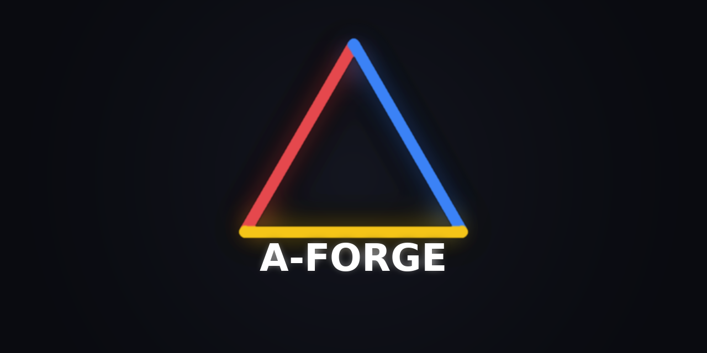

<!-- CURRENT-VERIFIED-STATE :: 2026-10-11 hand-audit evidence lives in the GENERATED block below + docs/state/forge-state.json · pre-doctrine text: docs/archive/README-2026-10-16-pre-doctrine.md -->

<!-- SOT-MANIFEST
federation_release: v2026.09.17
last_verified: 2026-09-16T16:35:00Z
live_commit: cbc25cb4 (runtime-reported via :7072/health)
sense_port: 7071 (healthy)
forge_port: 7072 (healthy)
tools_live: 122 (tools_listed via :7072/health · re-probed 2026-10-11) · 87 stateless
authority_ceiling: 777_FORGE (execution only — never adjudicate)
apex_zen: A2A delegates ⊥ MCP equips ⊥ ACT mutates ⊥ arifOS governs ⊥ F13 decides
act_ingress: HMAC-SHA256 PATH PRESENT · end-to-end identity binding NOT proven (sessionGate verdict-string inference is an open defect — see generated block)
infra_organs: arifFlow:7073 METABOLISM, FED:7074 ADVISORY, FRAME:frame-organ OBSERVE (FLAME:18901 decommissioned 2026-09-04)
truth_rule: MCP tools/list on :7072 beats any static count in prose
public_a2a_card: none by default — A-FORGE is actuator, not a public A2A mind
-->

<a id="current-verified-state"></a>
<!-- GENERATED:CURRENT-STATE:BEGIN · source: scripts/generate_forge_state.py · never hand-edit -->
> ### ⚠️ Current verified state — generated, never hand-edited
>
> **Runtime self-measurement** (`http://127.0.0.1:7072/health @2026-10-16T09:05:54Z`): **healthy** · commit `adb09ef3` · tools listed **122** (87 stateless) · authority ceiling `777_FORGE` · transport streamable-http.
>
> **Independent/hand audit** (2026-10-11, live re-probe by FI-008 (forge_registry_status + observed MUTATE-class call)): a MUTATE-class call without presented authority was stopped by A_THINK_GUARD (BUDGET: max_tools=0). Enforcement is **action class + budget — NOT a SEAL verdict binding**. **Audit follow-up (2026-10-19, code re-read):** two defects from that audit are already fixed in code — `invocationLog.ts` now writes `verdict`, `gate`, `can_claim_success` and defaults `ok:false` on HOLD/VOID; `sessionGate.ts` now verifies only `actor.actor_verified === true` (the `status=="resumed"` / `verdict=="SEAL"` inference is removed). **Still open:** `forgeShell.ts`, `mcp-bridge.ts`, and `interfaces/mcp/core.ts:1452` still infer identity/validity from `status=="PASS"/"resumed" || verdict=="SEAL"`; `mcp-bridge.ts` also defaults `scope_valid`/`replay_safe` to true when `meta.*` is absent; default session ids still use a `SEAL-` prefix; refusal-cause coverage in the ledger is not proven.
>
> **Self-measurement ≠ independent audit.** A tested unauthorised MUTATE-class request was
> refused; universal SEAL-verdict binding is the **target architecture, not the measured
> enforcement mechanism**. If this block conflicts with the live gateway, the gateway wins —
> re-run `python scripts/generate_forge_state.py`.
>
> Machine state: [`docs/state/forge-state.json`](./docs/state/forge-state.json) ·
> Badge feed: [`docs/state/badges/`](./docs/state/badges/)
<!-- GENERATED:CURRENT-STATE:END -->

<p align="center">
  
</p>

# A-FORGE

### Execution without self-authorization.

A-FORGE is the **execution plane** of the arifOS federation. It exposes bounded operational capabilities for code, infrastructure, security, web interaction and orchestration — and it does not judge, authorize or certify its own work.

> **A tested unauthorised MUTATE-class request was refused.**
> Universal SEAL-verdict-bound execution is the **target architecture, not yet the measured enforcement mechanism.**

**The hands never judge. Capability is not permission.**

[Quick Start](#30-second-proof-read-only) · [Current Verified State](#current-verified-state) · [Enforcement Model](#current-enforcement-model-measured) · [Known Defects](#known-defects) · [Tool Discovery](#tool-discovery) · [Security](#security-and-threat-boundary)

[](https://github.com/ariffazil/A-FORGE/actions)
[](https://github.com/ariffazil/A-FORGE/actions)
[](#current-enforcement-model-measured)
[](#tool-discovery)
[](#known-defects)
[](https://github.com/agentrust-io/awesome-ai-governance#governance-frameworks)
[](./LICENSE)

---

## What A-FORGE executes

- **Code:** inspect, patch, validate and stage repositories (LSP-gated edits, governed git, GitHub bridge)
- **Infrastructure:** containers, services, ports, deploys and fleet health (Docker, systemd, Caddy, sandbox lifecycle)
- **Security:** boundary scans, secret/pattern scanning, drift against the Machine Constitution
- **Web:** governed URL intake, federated search, SPA-aware extraction, browser actuation — evidence in, provenance out
- **Orchestration:** bounded multi-step execution — task compilation, composition bus, A2A fan-out, experience traces

Capability discovery does not grant capability use. Mutation requires the applicable runtime gates. Full domain detail with tool names: [`docs/README-FULL.md`](./docs/README-FULL.md) (if present) or `tools/list` on `:7072` — the wire is the catalog.

---

## 30-second proof (read-only)

Start the local gateway, or point at the live one on `:7072`:

```bash
npm ci && npm run build && npm start

# inspect the live registry — no session, no mutation
curl -sf http://localhost:7072/health | jq '{status, commit, tools_listed, stateless_tools}'
# → { "status": "healthy", "commit": "adb09ef3", "tools_listed": 122, "stateless_tools": 87 }   (probe 2026-10-16)

curl -sf http://localhost:7072/tools/list | jq 'map({name, description})[:5]'
```

The refusal evidence is a **measured observation**, not a demo script: on 2026-10-11 a MUTATE-class call without presented authority was stopped by `A_THINK_GUARD` (`BUDGET: max_tools=0`). A packaged `proof:unauthorized-mutation-refusal` fixture does **not** exist yet — building a reproducible fixture is an open work item (see Known Defects); we do not document commands that do not exist.

---

## Current enforcement model (measured)

```
Request
→ classify action          (action class)
→ assign budget            (leases · BUDGET gates)
→ A_THINK_GUARD            (refusal path — MEASURED 2026-10-11)
→ execute or refuse
→ telemetry + receipt      (FIDELITY NOT YET PROVEN)
```

**What is measured:** deterministic refusal of an unauthorised MUTATE-class call through action-class and budget enforcement.

**What is not measured:** that every execution is bound to a genuine `SEAL` verdict, a verified human or agent identity, and a faithful, independently reconstructable receipt.

The intended 4-layer gate model and the Gödel Lock (A-FORGE cannot reach judge `666` or seal `999` — the executor never certifies its own output; `888` is the retired judge label): [`docs/GATE_MODEL.md`](./docs/GATE_MODEL.md).

## Target constitutional architecture (TARGET — not currently proven)

```
Signed actor
→ scoped proposal
→ independent judgment (arifOS)
→ transaction-bound authorization
→ leased execution
→ verified consequence
→ faithful receipt
→ external reconstruction
```

The gap between the two diagrams above is the honest state of this component.

---

## Known defects

Each defect is a measured observation (hand-audit 2026-10-11; receipts in [`CURRENT_VERIFIED_STATE.md`](./CURRENT_VERIFIED_STATE.md) where present):

| Defect | Consequence | Status |
|---|---|---|
| Invocation-telemetry writer has governance fields, but the registration wrapper never feeds them | `withInvocationLog` (`invocationLog.ts:226`) omits `verdict`/`gate`/`refusal_cause`, so a kernel HOLD still persists as `ok:true` with `verdict:null` | **Open** — partial fix only (fields + HOLD/VOID `ok:false` default live at `invocationLog.ts:123`); measured 2026-10-25: 331/331 A-FORGE ledger lines carry `verdict:null` |
| Refusal cause (`A_THINK_GUARD`) logged 0× | the ledger cannot explain why a refusal happened | **Open** — re-measured 2026-10-25: `refusal_cause` non-null in 0 of 22,492 ledger lines |
| `sessionGate.ts:315` inferred `verified` from `verdict === "SEAL"` | a verdict string is not identity evidence | **Fixed** (2026-10-25 probe) — inference removed at `sessionGate.ts:316-319`; `interfaces/mcp/core.ts:1488-89` binds identity only via `actor.actor_verified === true` |
| Default session ids manufactured with `SEAL-` prefix | `SEAL` label collision in this codebase | **Open** |
| No reproducible unauthorised-mutation refusal fixture | refusal is evidenced by observation, not by a runnable proof | **Open** — build fixture first, then document it |

---

## Tool discovery

```bash
curl -sf http://localhost:7072/health | jq .tools_listed      # the only count to quote
curl -sf http://localhost:7072/tools/list | jq '.[].name'
```

Machine projection: [`docs/state/forge-state.json`](./docs/state/forge-state.json) (generated by `scripts/generate_forge_state.py`).

**Live truth rule:** `tools/list` on `:7072` beats any static count in prose. If the badge, the README and the wire disagree, the wire wins.

Fabric sensors that keep declared and live capability in agreement (`forge_registry_status`, `forge_fingerprint_check`, `forge_surface_audit`): [`docs/CAPABILITY_FABRIC.md`](./docs/CAPABILITY_FABRIC.md). One law: **CAPABILITY ≠ AUTHORITY** — knowing a tool exists never implies permission to use it.

Observability surfaces (shell ledger, RSI control loop, world-model quality, evidence packets): [`docs/OBSERVABILITY.md`](./docs/OBSERVABILITY.md).

---

## Security and threat boundary

- A-FORGE is an **actuator**. It is not a public A2A mind and publishes no agent card by default.
- ACT ingress carries HMAC-SHA256 verification **on the transport path**; end-to-end identity binding is **not proven** (see Known Defects). Treat `verified` flags in session output as claims until the verdict-string inference defect is closed.
- Secret/pattern scanning runs before execution (L1 AMANAH); F13 consent-gated confirmations exist for irreversible classes (`forge_send_confirm`, `forge_transfer_confirm`).
- Production operations runbook (rebuild, `systemctl restart a-forge-mcp.service`, fleet checks): [`RUNBOOK.md`](./RUNBOOK.md).

---

## External Footprint & Discovery

A-FORGE is the execution plane of the arifOS federation and is publicly discoverable as part of the ecosystem.

- **Discoverable:** YES (GitHub repository, cataloged in Agentrust Awesome-AI-Governance)
- **Installable / Callable:** YES (Governed stdio & HTTP MCP endpoint)
- **Inspectable & Forkable:** YES
- **Independent Validation:** NOT YET ESTABLISHED

*Execution without a prior kernel SEAL verdict is strictly prohibited.*

Canonical Witness Ledger: [EXTERNAL_WITNESS_LEDGER.md](https://github.com/ariffazil/arifOS/blob/main/docs/EXTERNAL_WITNESS_LEDGER.md)

---

## Federation role

A-FORGE occupies **station 777** in the federation's canonical ladder (000–999):

| Station | Organ | Authority | Relationship to A-FORGE |
|---|---|---|---|
| 000–666 | arifOS (cognition) | Route, sense, reason, direct | Provides evidence — never direct commands |
| **777** | **A-FORGE** | **Execute only** | **The only mutation station — lease + session + gates** |
| **666** | arifOS (judge) | SEAL / HOLD / VOID | A-FORGE cannot reach this station — no self-adjudication |
| 999 | VAULT999 | Immutable seal chain | A-FORGE writes receipts; kernel seals them |

> **Stage-map note:** the canonical live wire is `666 JUDGE → 777 FORGE → 999 SEAL`. `888` is the retired judge label and survives only in historical mirrors. See arifOS `README.md` §Stage numbering.

```
ARIF (Sovereign) → arifOS (Judge) → AAA (Router) → A-FORGE (Executor) → VAULT999 (Seal)
```

| Organ | Repository | Role | Endpoint |
|---|---|---|---|
| **Kernel** | [arifOS](https://github.com/ariffazil/arifOS) | Constitutional judge — SEAL/HOLD/VOID | :8088 |
| **Cockpit** | [AAA](https://github.com/ariffazil/AAA) | A2A mesh, routing, and display | :3001 |
| **Earth** | [GEOX](https://github.com/ariffazil/GEOX) | Geoscience evidence and physical grounding | :8081 |
| **Capital** | [WEALTH](https://github.com/ariffazil/WEALTH) | Financial risk and consequence modeling | :18082 |
| **Vitality** | [WELL](https://github.com/ariffazil/WELL) | Human readiness and dignity mirror | :18083 |
| **Metabolism** | [arifFlow](https://github.com/ariffazil/arifFLOW) | Federation health and FQ scheduling | :7073 |
| **Observation** | [FRAME](https://github.com/ariffazil/FRAME) | Passive monitoring and drift detection | frame-organ |

Full federation contract: [`FEDERATION_CONTRACT.md`](./FEDERATION_CONTRACT.md)

---

## Local development

```bash
git clone https://github.com/ariffazil/A-FORGE.git
cd A-FORGE
npm install && npm run build
npm start                 # HTTP gateway :7072
npm run mcp:stdio         # stdio transport for agent CLIs
npm test                  # full test suite
```

CI gates on every merge: **agentic-ci** (build/test/conformance) · **a-forge-boundary-guard** (authority ceiling enforcement — no tool may adjudicate) · **governance-gate** (kernel bridge contract). Dependabot runs unprivileged with constitutional package denylists requiring F13 review.

## License

**GNU Affero General Public License v3.0** (AGPL-3.0). Sovereign: **ARIF FAZ** (F13).

---

> *The hands never judge. The forge never self-authorizes.*
>
> **DITEMPA BUKAN DIBERI** — *Forged, Not Given.*

<!-- FEDERATION-STANDARD v2026-10-15 START :: 333-AGI audit :: source: organs.yaml + git + live probes -->
## 🔗 Federation Identity
| Field | Value |
|---|---|
| Organ | `a-forge` · CORE · execution_actuator |
| Ports | API 7071 · MCP 7072 |
| Unit | aforge units |
| Authority ceiling | EXECUTE_AFTER_SEAL |
| Public MCP | https://mcp.arif-fazil.com/mcp |
| Flow graph | [FEDERATION.md](https://github.com/ariffazil/AAA/blob/main/FEDERATION.md) — peta semua organ + repo |
<!-- FEDERATION-STANDARD v2026-10-15 END -->
